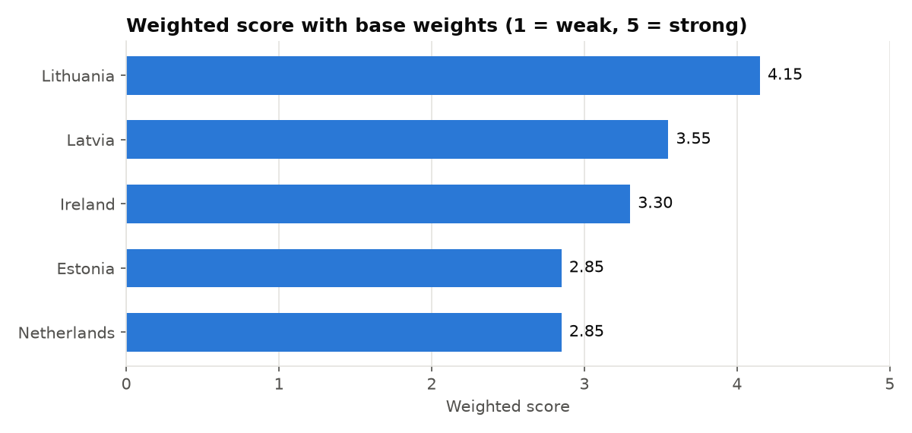
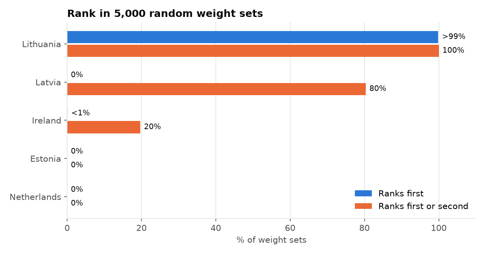
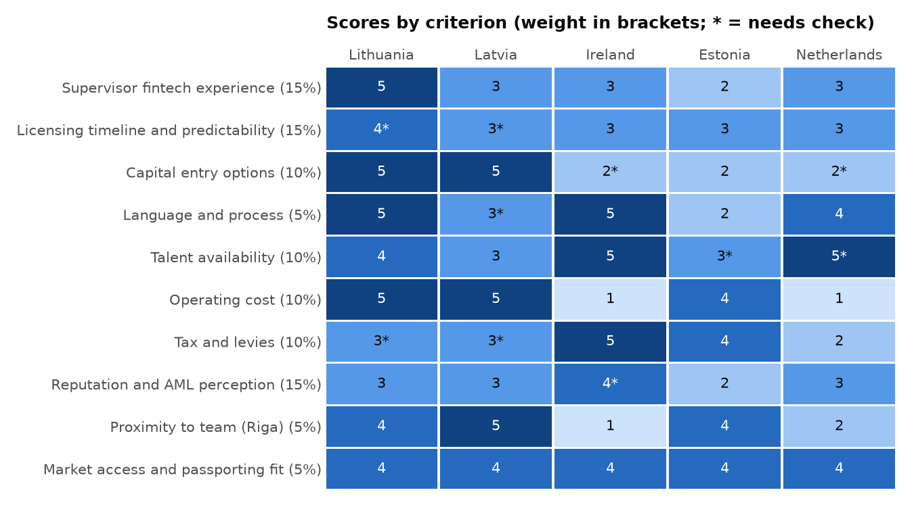

# Where to license a new digital bank: a jurisdiction comparison

A transparent, source-backed tool that compares five euro-area countries as a home for a **new deposit-funded digital consumer lender** with a team based in Riga: Lithuania, Latvia, Ireland, the Netherlands and Estonia.

Each country gets a score from 1 to 5 on ten weighted criteria. Each score comes with a written rationale, source links and a check date. The tool then asks how much the answer depends on the weights and on the scores. It does this with 5,000 random weight sets, 5,000 draws in which every score moves by up to one point, and by finding the weight at which each criterion would change the winner.

It is the companion to [bank-model](https://github.com/udrism-lang/bank-model), which sizes the capital the same bank would need, and to [neobank-benchmarks](https://github.com/udrism-lang/neobank-benchmarks), which compares it with real banks.

## Key findings

**With base weights, Lithuania ranks first; Lithuania stays first in 99.9% of 5,000 random weight sets and in 93.6% of 5,000 draws with every score moved by -1, 0 or +1. The decision is most sensitive to tax and levies: moving its weight from 10% to 37% puts Ireland first.**

| Rank | Country | Weighted score | First in random weight sets | First or second | First with scores ±1 |
|---|---|---|---|---|---|
| 1 | Lithuania | 4.15 | 99.9% | 100% | 93.6% |
| 2 | Latvia | 3.55 | 0% | 80.3% | 5.1% |
| 3 | Ireland | 3.30 | 0.1% | 19.7% | 1.2% |
| 4= | Estonia | 2.85 | 0% | 0% | 0.1% |
| 4= | Netherlands | 2.85 | 0% | 0% | 0% |

The weight test and the score test answer different questions. The first asks whether the result depends on how the criteria are weighted. The second asks whether it depends on any single score being one point off.

1. **Lithuania wins on what matters most for a first licence.** It has the deepest fintech licensing track record (Revolut Bank and about eight specialised banks), a EUR 1m specialised bank regime and English-language applications. Its costs are close to Riga's. Its weak spots are reputation (Lietuvos bankas fined Revolut Bank EUR 3.5m in 2025) and a 22% tax rate on bank profits. A bill to raise that to 27% (XVP-973) was registered in 2025; its adoption was not confirmed as of 15.11.2026.
2. **Latvia is a clear second.** It leads Ireland on cost, capital entry and proximity. Its AML reputation now scores 3, the same as Lithuania: MONEYVAL's 2025 evaluation, the first under the FATF 2022 methodology, found its AML/CFT system effective overall. Ireland leads on tax (12.5%), talent and reputation, but its licensing takes about a year. Under random weights Latvia is in the top two 80% of the time and Ireland 20%.
3. **The ranking only changes if a single criterion dominates.** Each threshold below is the weight one criterion would need, with the others scaled down, before a new country comes first:
   - tax and levies at 37% puts Ireland first;
   - proximity to Riga at 41% puts Latvia first;
   - talent at 51% puts Ireland first;
   - AML reputation at 54% puts Ireland first.

   No weight on supervisor experience, licensing timeline, capital entry, cost, language or market access moves Lithuania from first.
4. **Latvia's gap to Lithuania is mostly track record, and that can change.** Of the 0.60-point gap, 0.45 comes from supervisor fintech experience and licensing predictability. Latvia's specialised credit institution regime (EUR 1m, in force since 06.01.2026, explicitly open to digital-only banks) has no licences yet. If the first ones went as smoothly as Lithuania's, the gap would shrink to 0.15.
5. **The capital saving of the EUR 1m regimes is smaller than it looks.** A digital bank needs EUR 20-50m to fund its losses until break-even (bank-model's base case needs about EUR 38m). The real value of a specialised regime is a faster, more proportionate supervisory dialogue, not the EUR 4m saved. Capital entry still carries 10% of the weight. Without that criterion Lithuania stays first (4.06, ahead of Ireland at 3.44 and Latvia at 3.39).
6. **Market access does not affect the ranking.** All five are euro-area Banking Union members with the same EU passport, so all score 4. The criterion adds the same 0.20 points to every total.







## Criteria and base weights

| Criterion | Weight | What it measures |
|---|---|---|
| Supervisor fintech experience | 15% | Recent fintech and neobank licences, innovation hub, sandbox, pre-application dialogue |
| Licensing timeline and predictability | 15% | Typical time to a licence and how transparent the process is |
| Reputation and AML perception | 15% | Recent AML cases and MONEYVAL/FATF status, as seen by correspondent banks and partners |
| Capital entry options | 10% | A specialised regime below the EUR 5m CRD minimum |
| Talent availability | 10% | Banking, risk, AML and IT specialists |
| Operating cost | 10% | Finance-sector labour cost (Eurostat) and prime office rent. For the Netherlands, Eurostat's finance-sector figure is confidential, so the whole-economy figure is used |
| Tax and levies | 10% | Corporate income tax on bank profits, bank surcharges and levies |
| Language and process | 5% | Whether an application can be filed in English |
| Proximity to team (Riga) | 5% | Distance from the team |
| Market access and passporting fit | 5% | Euro area and EU passport (identical for all five today) |

Change any weight or score in [`data/jurisdictions.yaml`](data/jurisdictions.yaml) and re-run.

## How it works

```
Score           weighted sum of 1-5 scores; ties broken by country code so the order is deterministic
Monte Carlo     5,000 weight sets drawn from a Dirichlet distribution centred on the base weights
                (concentration 50: a 15% weight typically lands between ~10% and ~20%);
                counts how often each country ranks first and in the top two
Score check     5,000 draws with base weights; every score moves by a random -1, 0 or +1 (clipped to 1-5);
                counts how often each country ranks first (fixed seed, so it is reproducible)
Thresholds      for each criterion, move its weight from 0% to 100% (others scaled to keep the sum at 1)
                and find the nearest weight at which another country scores strictly higher
```

## Evidence standard

- Every score has a rationale, at least one source URL and a `last_checked` date: 31.10.2026, or 15.11.2026 for scores re-checked in a November review.
- Primary sources come first: supervisors (Lietuvos bankas, Latvijas Banka, Central Bank of Ireland, DNB, Finantsinspektsioon), the ECB, law portals, Eurostat and national statistics. Big-4 tax summaries, law firms and reputable press come next.
- **10 of 50 scores are flagged `needs_check: true`**. These are scores where the evidence came from secondary sources or a fact could not be confirmed. They are marked with * in the charts and listed in `output/summary.md`:
  - licensing time in Lithuania and Latvia (no official average published);
  - whether Latvijas Banka accepts applications in English;
  - whether Ireland and the Netherlands really have no reduced-capital regime;
  - whether Lithuania adopted bill XVP-973, which would raise the bank surcharge from 5% to 10% (adoption not confirmed as of 15.11.2026);
  - how Latvia's solidarity contribution, which uses a 2018-2022 base, applies to a new bank;
  - Ireland's AML record for banks, and talent-pool data for the Netherlands and Estonia.
- The scores themselves are judgement. The point of the tool is to make that judgement explicit, sourced and testable, not to hide it.

## Run it

Requires Python 3.10+.

**Windows (PowerShell):**

```powershell
.\run.ps1
```

The script creates a virtual environment on first run, installs dependencies, runs the tests and the comparison, and opens the `output` folder.

**Any platform:**

```bash
pip install -r requirements.txt
pytest -q
python run.py
```

Outputs in `output/`: `report.html` (a single file with the ranking, a score table with hover rationales, threshold table and country cards with source links), `summary.md` and three charts.

## Project structure

```
data/jurisdictions.yaml    countries, criteria, weights, scores, rationales and sources
jurisdiction/score.py      load, validate, weighted score, deterministic ranking
jurisdiction/robustness.py Monte Carlo on weights and on scores, weight thresholds
jurisdiction/report.py     charts, markdown summary, single-file HTML report
run.py                     command-line entry point
tests/                     data quality and method tests
docs/                      charts used in this README
```

## Tests

- weights sum to 1;
- every score is an integer from 1 to 5 and has a source or a `needs_check` flag, plus a check date;
- every country is scored on every criterion;
- the ranking is deterministic, and ties are broken by country code;
- Monte Carlo shares (weights and scores) sum to 100% and are reproducible with a seed;
- tied ranks are shown as "4=";
- the validator catches bad data;
- each reported threshold really changes the leader, and a tie never counts as overtaking.

## Limitations and next steps

- Five euro-area countries only. Adding a non-euro option (for example Poland or Sweden) would make `market_access` matter.
- Scores are ordinal judgements. A next version could score some criteria directly from data (labour cost, tax rate, licensing days).
- A licence needs real management substance in the licensing country. The ECB and national supervisors expect the management body and key functions to be present there. A Lithuanian licence therefore means a board and management presence in Vilnius, not only a team in Riga. The proximity score only partly captures this.
- Operating cost for the Netherlands uses whole-economy labour cost, while the other four use finance-sector data. Eurostat does not publish the Dutch finance-sector figure. The Netherlands scores 1 either way, so the ranking does not change.
- Licensing practice changes fast. In particular, re-check Latvia's new specialised regime once the first licences are granted.

---

Built with AI-assisted development (Claude). Research agents collected the evidence. Each score is recorded in `data/jurisdictions.yaml` with its rationale, sources and check date. A review in November 2026 corrected several facts. Scores flagged `needs_check` are not fully confirmed.
